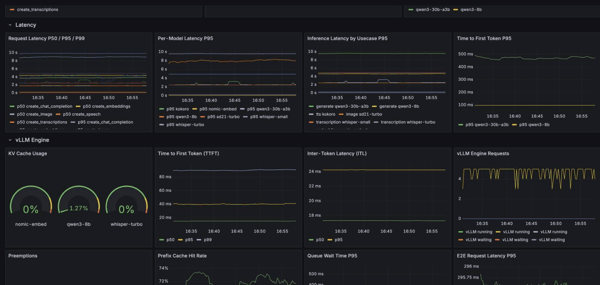

# Modelship

**Your agents already speak OpenAI. Give them a `/v1/responses` backend you own.**

Modelship serves the whole agentic surface — reasoning, tool calling,
server-side conversation state, and MCP servers the gateway calls for you — and
scores **17/17** on the independent
[Open Responses](https://github.com/openresponses/openresponses) conformance
suite. Embeddings, speech, and image generation ride the same `/v1`. Change the
base URL and your agent runs unchanged, on hardware you control.

[Quick start :material-arrow-right:](#quick-start){ .md-button .md-button--primary }
[View on GitHub :fontawesome-brands-github:](https://github.com/modelship-ai/modelship){ .md-button }

## Quick start

One command, one model. Pick your hardware.

=== "CPU"

    Linux, Windows, or macOS via Docker. Images are multi-arch (amd64 + arm64).

    ```bash
    docker run --rm --shm-size=8g -p 8000:8000 -v modelship-cache:/.cache \
      ghcr.io/modelship-ai/modelship:latest-cpu start \
      --model "Qwen/Qwen3-8B-GGUF:*Q4_K_M.gguf" --model.loader llama_server \
      --model.usecase generate --model.num-cpus 4
    ```

=== "NVIDIA GPU"

    Needs the [NVIDIA Container Toolkit](https://docs.nvidia.com/datacenter/cloud-native/container-toolkit/install-guide.html).

    ```bash
    docker run --rm --shm-size=8g --gpus all -p 8000:8000 -v modelship-cache:/.cache \
      ghcr.io/modelship-ai/modelship:latest-cuda start \
      --model "Qwen/Qwen3-8B-GGUF:*Q4_K_M.gguf" --model.loader llama_server \
      --model.usecase generate --model.num-gpus 1
    ```

=== "AMD or Intel GPU"

    Linux, through Vulkan. Images are multi-arch (amd64 + arm64).

    ```bash
    docker run --rm --shm-size=8g --device /dev/dri -p 8000:8000 -v modelship-cache:/.cache \
      ghcr.io/modelship-ai/modelship:latest-vulkan start \
      --model "Qwen/Qwen3-8B-GGUF:*Q4_K_M.gguf" --model.loader llama_server \
      --model.usecase generate --model.num-gpus 1
    ```

=== "Apple Silicon"

    Native install, with Metal offload.

    ```bash
    uv tool install mship && mship bootstrap --metal
    mship start --model "Qwen/Qwen3-8B-GGUF:*Q4_K_M.gguf" --model.loader llama_server \
      --model.usecase generate --model.num-gpus 1
    ```

Wait for the `Deploy … succeeded` log line, then talk to it — this hits
the **Responses API** and streams the model's reasoning as it thinks:

```bash
uvx --with httpx llm openai endpoint http://localhost:8000/modelship/v1 \
  -m qwen3-8b --responses "Which is larger, 9.11 or 9.9?"
```

Add `--chat` for an interactive session, `-T` to hand it a tool, or `--models`
to list what's deployed.

The model serves as `qwen3-8b`, inferred from the reference. It pulls ~5 GB and
wants ~10 GB of free RAM; `--model.num-cpus 4` reserves four cores for it, so lower it
if the container has fewer (the deploy waits for resources it can't get). On a
small box, swap in `lmstudio-community/Qwen3-0.6B-GGUF:*Q4_K_M.gguf`.

Every key of a model's config has a flag (`--model.llama-server-config.n-ctx 8192`),
and repeating `--model` deploys several models at once, each followed by its own
flags; a `models.yaml` does the same from a file — see
[Model Configuration](model-configuration.md).
Hitting an error? Check [Troubleshooting](troubleshooting.md).

??? note "Prefer `curl`?"

    ```bash
    curl http://localhost:8000/modelship/v1/responses \
      -H "Content-Type: application/json" \
      -d '{"model": "qwen3-8b", "input": "Which is larger, 9.11 or 9.9?"}'
    ```

    The response carries both `output_text` and a first-class `reasoning`
    output item. `/modelship/v1/chat/completions` is there too, if that's what
    your client speaks.

!!! tip
    Always set `--shm-size=8g` (or higher) — Ray falls back to slower
    disk-backed storage instead of `/dev/shm` if the container's shared memory
    is too small for the object store.

## Open Responses conformance

`/v1/responses` is tested against the independent
[Open Responses](https://github.com/openresponses/openresponses) compliance
suite (`bun run test:compliance`), which drives the endpoint over real HTTP
against a live deployment rather than mocks.

**Latest result: 17/17** — every core, compaction, vision, and WebSocket test
(`Qwen3-VL-8B-Instruct` AWQ 4-bit, vLLM, 2026-10-04).

**Loader parity:** the `vllm` and `llama_server` loaders return the same result
on all 17 tests.

Fourteen cluster guarantees — zero-downtime model cutover, load-driven
autoscaling, engine crash recovery, fractional-GPU multi-tenancy, server-side
MCP tool loops — are likewise asserted end-to-end against a live cluster with
real models over real HTTP. See
[Verified cluster behaviour](production-readiness.md#verified-cluster-behaviour).

## Why Modelship?

- **Conversations that survive the replica that started them** — `previous_response_id`,
  reasoning, and tool state live in one store every gateway replica shares: a
  Ray actor by default, Redis when you want it to outlive the cluster. Scale
  the gateway out without sharding your users onto specific replicas.
- **One endpoint for the whole app** — chat, embeddings for RAG,
  speech-to-text, text-to-speech, and image generation on a single
  OpenAI-compatible `/v1`, instead of a service per modality.
- **A stack that fits the hardware you have** — allocate GPU fractions per
  model (70% for the LLM, 5% for TTS), or run the same model CPU-only. vLLM,
  llama.cpp, stable-diffusion.cpp, Diffusers, sherpa-onnx, and whisper.cpp
  coexist in one deployment.
- **Changes you can ship on a Tuesday** — edit the model set and reconcile:
  models are added, replaced, or dropped incrementally, with a blue-green
  cutover per model and no gateway restart.

## See it run

A pre-built Grafana dashboard ships with Modelship: request rates and latency
per model, time to first token, replica load, GPU and system resources, Ray
Serve internals and alert thresholds. Below, two nodes (an AMD Strix Halo on
Vulkan and an NVIDIA box with two GPUs) serve seven models on five loaders
under load:



See [Monitoring & Logging](monitoring.md) to connect Prometheus, import the
dashboard, and load the alert rules.

## Architecture


Each model runs as an isolated [Ray Serve](https://docs.ray.io/en/latest/serve/index.html)
deployment with its own lifecycle, health checks, and resource budget. Which
backends a node runs, and on which device, depends on its variant (the image
suffix or the `mship bootstrap` flag):

| Backend (`loader`) | Best for | `cuda` | `cpu` | `vulkan` | `metal` |
|---|---|---|---|---|---|
| **vLLM** (`vllm`) | High-throughput chat, embeddings, transcription, vision | GPU | CPU¹ | CPU¹ | — |
| **llama.cpp** (`llama_server`) | Quantized GGUF chat, embeddings, vision | GPU, CPU | CPU | GPU, CPU | GPU, CPU |
| **stable-diffusion.cpp** (`stable_diffusion_cpp`) | GGUF image generation (SD, Flux) | GPU, CPU | CPU | GPU, CPU | GPU, CPU |
| **Diffusers** (`diffusers`) | Image generation | GPU, CPU | — | — | — |
| **whisper.cpp** (`whispercpp`) | Speech-to-text | CPU | CPU | CPU | GPU, CPU |
| **sherpa-onnx** (`sherpa_onnx`) | Text-to-speech (Kokoro), speech-to-text (Parakeet) | CPU | CPU | CPU | CPU |

GPU means an NVIDIA GPU on `cuda`, an AMD or Intel GPU through Vulkan on
`vulkan`, and Apple Silicon on `metal`. ¹ Linux only. The `thin` variant is a
coordinator and runs no models.

Models can be deployed across multiple GPUs or run on CPU-only. A model name
maps to one deployment, which scales horizontally with `num_replicas`
(Ray Serve load-balances across its own replicas); the gateway itself autoscales
with its load, and several gateways can share one cluster and one
port (`--gateway-name`), each mounted at `/<name>/v1` with its own model set.
See [Architecture](architecture.md) for the full request lifecycle and design.

## Supported OpenAI Endpoints

| Endpoint | Usecase |
|---|---|
| `POST /v1/chat/completions` | Chat / text generation (streaming and non-streaming) |
| `POST /v1/responses` | Responses API — text, reasoning, client-driven tool calls, server-side MCP tool execution, and stored conversations (streaming and non-streaming) |
| `GET`/`DELETE /v1/responses/{id}` | Fetch or drop a stored response (`/input_items` lists its input); `background: true` on create + `POST .../cancel` for queued/pollable runs |
| `POST /v1/embeddings` | Text embeddings |
| `POST /v1/audio/transcriptions` | Speech-to-text |
| `POST /v1/audio/translations` | Audio translation |
| `POST /v1/audio/speech` | Text-to-speech (SSE streaming or single-response) |
| `POST /v1/images/generations` | Image generation |
| `GET /v1/models` | List available models and [pipelines](model-configuration.md#pipelines-experimental) |
| `WS /v1/realtime` | Realtime API on an `assistant` [pipeline](model-configuration.md#pipelines-experimental). Experimental: text and voice conversations, function tools, turn detection (server VAD, semantic VAD or client commit), wake words and talking over a spoken answer |

## Next steps

- [Installation](installation.md) — Docker, native, and Helm install guides
- [Model Configuration](model-configuration.md) — the full `models.yaml` reference
- [Integrations](integrations/index.md) — connecting the OpenAI SDK, Open WebUI, Dify, n8n, and Responses-speaking agents
- [Production Readiness](production-readiness.md) — verified cluster behaviour and the hardening roadmap
